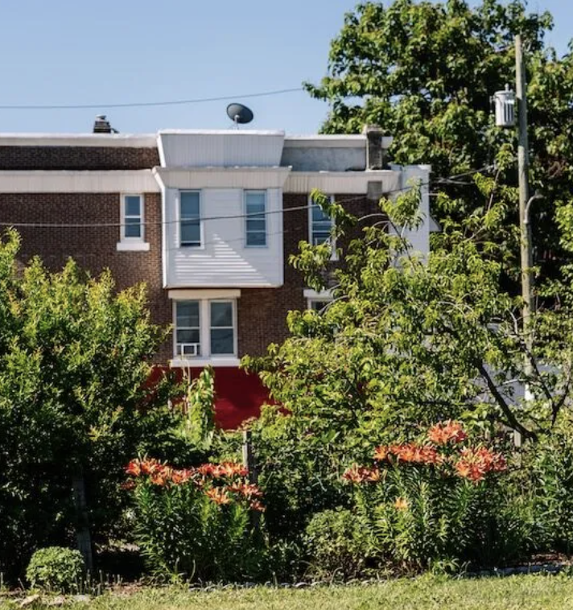
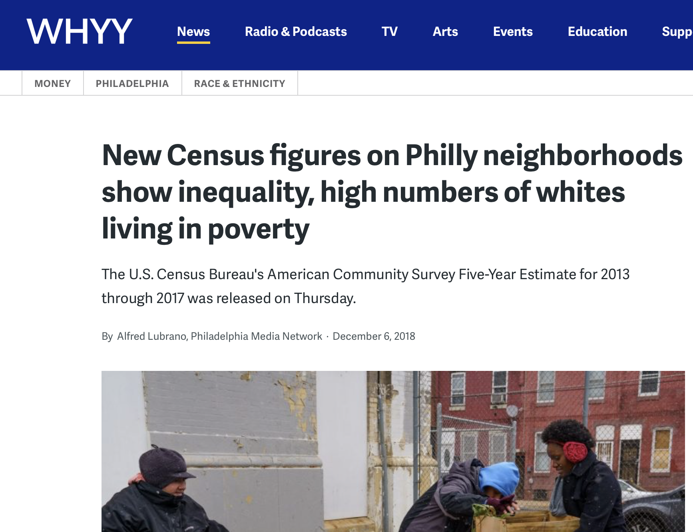

::::::::: {.grid}

::::: {.g-col-12 .g-col-md-6}
::: portfolio-card
{.tile-image}

::: tile-overlay
## Senior Thesis

Here is a shortened version of my undergraduate thesis exploring the relationship between rapid transit availability and in-person voter turnout in Philadelphia from 2021–2025, as moderated by socioeconomic status.

[See more](Thesis_UG.pdf){.stretched-link}
:::
:::
:::::

::::: {.g-col-12 .g-col-md-6}
::: portfolio-card
{.tile-image}

::: tile-overlay
## Litter and Crime Experiment

Research project investigating how litter impacts rates of gun violence in Philadelphia from 2017–2019 through the Penn Undergraduate Research Mentoring Program. Supervised by Dr. John MacDonald.

[See more](CJP_Lab_Poster.pdf){.stretched-link}
:::
:::
:::::

::::: {.g-col-12 .g-col-md-6}
::: portfolio-card
{.tile-image}

::: tile-overlay
## American Community Survey Assignment

An assignment completed for the Public Policy Analytics course, investigating the statistical validity of claims using American Community Survey (ACS) data.

[See more](assignment3.html){.stretched-link}
:::
:::
:::::

:::::::::

