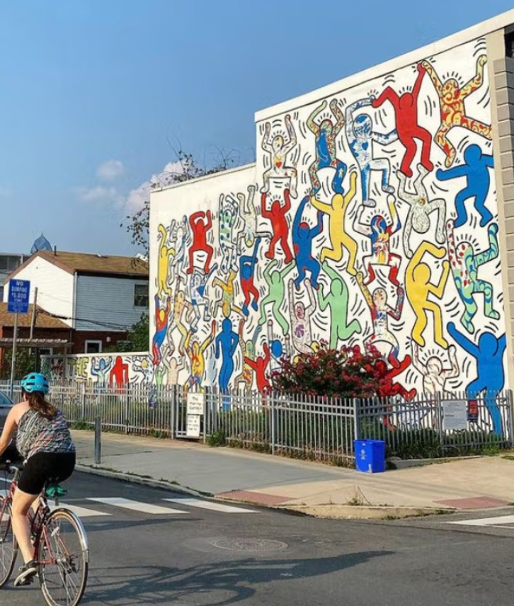
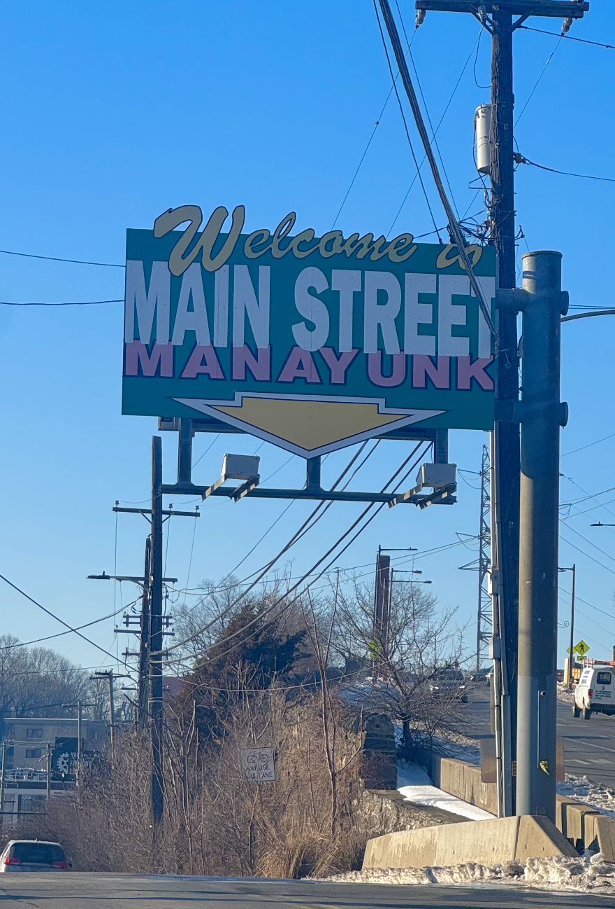

::::::::: grid
::::: {.g-col-12 .g-col-md-6}
:::: portfolio-card
{.tile-image}

::: tile-overlay
## Point Breeze Report

"Group project detailing the existing conditions of the Point Breeze neighborhood, Philadelphia. Co-wrote with Alexa Halim, Johnny Chen, and Maude Ceruso." 

[See more](Point Breeze Report.pdf){.stretched-link}
:::
::::
:::::

::::: {.g-col-12 .g-col-md-6}
:::: portfolio-card
{.tile-image}

::: tile-overlay
## Manayunk Neighborhood Plan

"Semester-long group planning project in the Manayunk neighborhood, Philadelphia. Group members listed in the report."

[See more](Manayunk Plan.pdf){.stretched-link}
:::
::::
:::::
:::::::::
